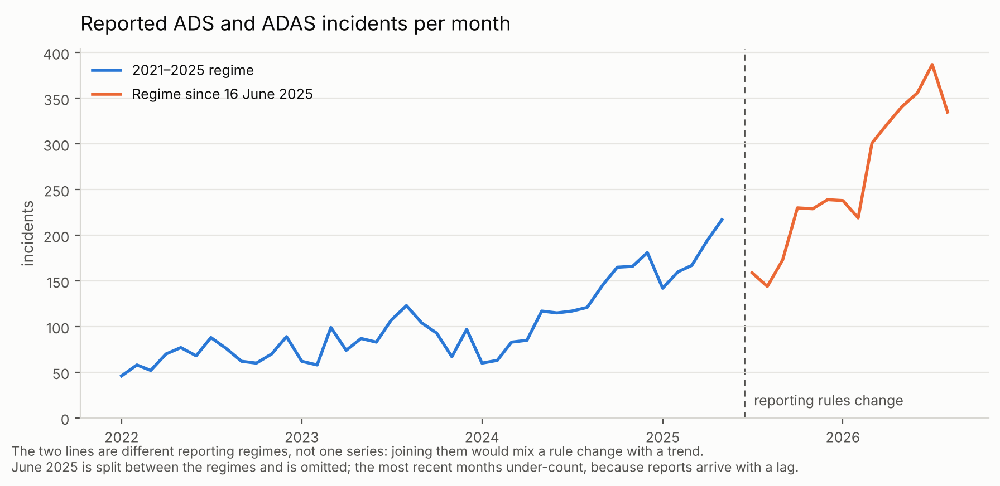

# Worked example: the 2025 reporting change

`regime_break.py` shows what the amended Standing General Order does to a
naive count of SGO crashes, and what `sgotools` does about it.

```bash
pip install -e ".[test]" matplotlib
python examples/regime_break.py                  # downloads a snapshot if needed
python examples/regime_break.py path/to/snapshot # or use one you already have
```

The output below is from the snapshot retrieved on 6 November 2026, covering
reports received through 15 September 2026. Your numbers will differ once
NHTSA publishes a further release — which is the point of recording the
snapshot date.

## 1. Rows are not crashes

```
                                       archive   current
  published rows                         9,920     4,201
  one row per Report ID                  8,160     4,010
  minus administrative filings           4,641     4,010
```

Counting published rows suggests crashes fell by 58% between the two files.
Two things cause most of that. Each revision of a report is published as its
own row, and under the old regime an entity with nothing to report still
filed a monthly record — 3,519 such rows sit in the archive files. Counting
incidents instead gives −14%, and even that is not a trend, because the two
files cover about 47 and 15 months.

## 2. An archive injury label matches nothing in current data

```
  archive, label 'No Injuries Reported'        1,981
  current, same label                              0   <- matches nothing
  current, closest new label                     146
  current, harmonised onto the archive scale   1,461
```

The 2025 amendment replaced the six-category injury scale with ten
categories. `No Injuries Reported` became both `No Injured Reported` and
`Property Damage. No Injured Reported`. A filter written against the old
label returns an empty frame with no error; the closest new label returns a
tenth of the comparable count. `harmonize_injury="legacy"` adds an
`injury_severity_harmonized` column that recovers the 1,461.

## 3. Monthly counts, split by regime



The two lines are the two reporting regimes. They are drawn separately on
purpose: the amendment narrowed what has to be reported and changed who
files, so a single line through June 2025 would mix a rule change with a
trend. June 2025 is split between the regimes and is left out, and the most
recent months under-count because reports arrive with a lag.

## 4. What was actually done to the data

```
Crash records were taken from the NHTSA Standing General Order incident
report files, retrieved 2026-11-06, current reporting regime only (ADS
files), processed with sgotools using: one row per Report ID (latest
version); administrative non-incident filings removed; injury severity
collapsed onto the pre-2025 scale. This yielded 1,551 incident records from
1,595 published rows.
```

Every loaded frame carries a `Provenance` object at
`df.attrs["provenance"]`, holding the options used, the rows each step
removed, and the SHA-256 digest of every file read. `summary()` prints the
full report; `methods_sentence()` prints the paragraph above.
